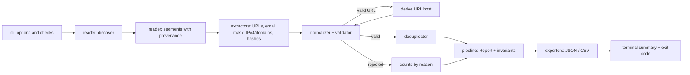

# Lucent

[](https://github.com/PranavY-01/Lucent/actions/workflows/ci.yml)

Offline Python CLI that extracts, validates, normalizes and deduplicates potential IOCs from security reports and logs, with source provenance and JSON/CSV export.

Part of the *7 Days – 7 Cybersecurity Projects* series.

## Why Lucent

Established open-source IOC extractors already exist, and Lucent does not claim better coverage than them. It focuses on a few things that matter when the output feeds a human review or another tool:

- **Provenance that survives deduplication.** Every unique indicator keeps the file and line, CSV record and column, or JSON path of each place it appeared, plus an occurrence count.
- **Report invariants enforced by tests.** Counts, ordering and status are checked by a model validator on every report, so the JSON and CSV can never disagree.
- **Explicit rejection reasons.** Candidates that fail validation are counted by reason (`unknown_tld`, `invalid_ipv4`, ...), not silently dropped.
- **Honest status semantics.** A run is `completed`, `completed_with_warnings` or `partial`, and the exit code says so.
- **Strictly offline.** No DNS, no HTTP, no lookups. Output says `valid_syntax`, never "malicious".

## Features

- Reads `.txt`, `.log`, `.md`, `.csv`, `.json`, `.jsonl` and `.ndjson`, single files or directories (optionally recursive).
- Extracts potential IPv4 addresses, domains, HTTP/HTTPS URLs, MD5, SHA-1 and SHA-256 hashes.
- Recovers common defanged forms (`example[.]com`, `hxxps[://]...`) and keeps the original text.
- Validates syntax per type, including the bundled IANA TLD list.
- Derives each valid URL's host as a `domain` or `ipv4` IOC, marked `"via": "url_host"`.
- Deduplicates by type and canonical value while merging sources.
- Exports JSON and CSV (to files, a directory, or stdout) with atomic writes and no silent overwrites.

## Scope and non-goals

Lucent extracts potential IOCs and validates their syntax. It does **not**: look up reputation, resolve DNS or make any network call, visit URLs, scan or probe hosts, execute or sandbox anything, analyze PCAP/memory/disk images, hash evidence files, parse timestamps or build timelines, integrate with a SIEM, or claim anything is malicious. IPv6, email addresses, Unicode IDNs and STIX export are out of scope for v1.

## Installation

Requires Python 3.11 or newer.

```bash
git clone https://github.com/PranavY-01/Lucent.git
cd Lucent
python -m venv .venv
# Windows PowerShell: .venv\Scripts\activate    otherwise: source .venv/bin/activate
python -m pip install -e ".[dev]"
lucent --version
```

```text
lucent 1.0.0
```

## Usage

```text
lucent scan INPUT [--recursive] [--format json|csv|both] [--output FILE | --output -]
                  [--output-dir DIR] [--force] [--strict]
                  [--max-file-size MB] [--max-files N] [--max-sources-per-ioc N]
                  [--allow-ambiguous-tlds] [--verbose | --quiet]
```

`python -m lucent_ioc ...` works the same way. All outputs below were produced by running the commands against this repository's `samples/` and `tests/fixtures/` (on Windows).

**Terminal summary only** (no destination, nothing is written):

```console
$ lucent scan samples/incident_report.txt
Input: incident_report.txt
Files: discovered 1, processed 1, skipped 0, failed 0
IOCs: 4 unique (ipv4 1, domain 1, url 1, md5 0, sha1 0, sha256 1)
Rejected candidates: 1 (ambiguous_file_extension_tld 1)
┌────────┬─────────────┬─────────┬────────────────────────────────────────────┐
│ type   │ occurrences │ sources │ value                                      │
├────────┼─────────────┼─────────┼────────────────────────────────────────────┤
│ ipv4   │ 2           │ 2       │ 203.0.113.10                               │
│ domain │ 2           │ 2       │ example.com                                │
│ url    │ 1           │ 1       │ https://example.com/test?id=42             │
│ sha256 │ 1           │ 1       │ aaaaaaaaaaaaaaaaaaaaaaaaaaaaaaaaaaaaaaaaaa │
│        │             │         │ aaaaaaaaaaaaaaaaaaaaaa                     │
└────────┴─────────────┴─────────┴────────────────────────────────────────────┘
Status: completed
```

The table shows at most 50 rows and then prints `showing 50 of N`.

**A directory, both formats:**

```console
$ lucent scan samples/ --recursive --format both --output-dir reports/
Input: samples
Files: discovered 4, processed 4, skipped 0, failed 0
IOCs: 30 unique (ipv4 8, domain 11, url 7, md5 1, sha1 1, sha256 2)
Rejected candidates: 5 (ambiguous_file_extension_tld 1, invalid_ipv4 1, unknown_tld 3)
Output: reports\lucent_iocs.json
Output: reports\lucent_iocs.csv
Status: completed
```

Running it again refuses to overwrite (exit code 1) unless `--force` is given:

```console
$ lucent scan samples/ --recursive --format both --output-dir reports/
Error: output file reports\lucent_iocs.json already exists (use --force to overwrite)
```

**CSV to stdout** (human-readable output goes to stderr, so stdout holds only the report):

```console
$ lucent scan samples/incident_report.txt --format csv --output -
type,value,validation_status,occurrences,source_count,original_values,sources
ipv4,203.0.113.10,valid_syntax,2,2,"[""203.0.113.10""]","[{""file"":""incident_report.txt"",""line"":2},{""file"":""incident_report.txt"",""line"":8}]"
domain,example.com,valid_syntax,2,2,"[""example[.]com""]","[{""file"":""incident_report.txt"",""line"":3},{""file"":""incident_report.txt"",""line"":4,""via"":""url_host""}]"
url,https://example.com/test?id=42,valid_syntax,1,1,"[""hxxps://example[.]com/test?id=42""]","[{""file"":""incident_report.txt"",""line"":4}]"
sha256,aaaaaaaaaaaaaaaaaaaaaaaaaaaaaaaaaaaaaaaaaaaaaaaaaaaaaaaaaaaaaaaa,valid_syntax,1,1,"[""aaaaaaaaaaaaaaaaaaaaaaaaaaaaaaaaaaaaaaaaaaaaaaaaaaaaaaaaaaaaaaaa""]","[{""file"":""incident_report.txt"",""line"":5}]"
```

**A directory with a broken file** (`--quiet` prints only errors and the status; exit code 3):

```console
$ lucent scan tests/fixtures/mixed --quiet
Error [parse] JSONDecodeError: malformed.json: invalid JSON at line 2
Status: partial
```

**Usage errors** exit with code 2:

```console
$ lucent scan samples/incident_report.txt --format both
Usage: lucent scan [OPTIONS] {INPUT}
Try 'lucent scan --help' for help.
┌─ Error ─────────────────────────────────────────────────────────────────────┐
│ Invalid value: --format both requires --output-dir.                         │
└─────────────────────────────────────────────────────────────────────────────┘
```

### Output rules

| Situation | Result |
|---|---|
| No `--output` / `--output-dir` | Terminal summary and table; no files written. `--format csv`/`both` need a destination. |
| `--output FILE` | One format written to FILE (parent directories created). |
| `--output -` | One format written to stdout; the summary goes to stderr. |
| `--output-dir DIR` | `lucent_iocs.json` and/or `lucent_iocs.csv` in DIR (created if missing). `--format both` requires it. |
| `--output` with `--output-dir`, or `--verbose` with `--quiet` | Usage error (exit 2). |
| Target file already exists | Exit 1 before writing anything, unless `--force`. |
| Output path is the input file | Exit 1, even with `--force`. |

Output files inside a scanned directory are never treated as inputs. All writes go to a temporary file in the target directory and are then atomically renamed.

## Sample input and output

`samples/incident_report.txt`:

```text
Incident ID: DEMO-001
Observed address: 203.0.113.10
Reported host: example[.]com
Reported URL: hxxps://example[.]com/test?id=42
SHA256: aaaaaaaaaaaaaaaaaaaaaaaaaaaaaaaaaaaaaaaaaaaaaaaaaaaaaaaaaaaaaaaa
Attachment: invoice.zip
Contact: analyst@example.org
Repeated address: 203.0.113.10
```

`lucent scan samples/incident_report.txt --output -` (exit code 0; actual output, `indent=2`):

```json
{
  "schema_version": "1.0",
  "tool": {
    "name": "Lucent",
    "version": "1.0.0"
  },
  "scan": {
    "timestamp_utc": "2026-10-28T15:50:05Z",
    "input": "incident_report.txt",
    "recursive": false,
    "strict": false,
    "allow_ambiguous_tlds": false,
    "status": "completed",
    "files": {
      "discovered": 1,
      "processed": 1,
      "skipped": 0,
      "failed": 0
    },
    "limits": {
      "max_file_size_bytes": 52428800,
      "max_files": 10000,
      "max_sources_per_ioc": 100
    },
    "tld_snapshot": "2026102800"
  },
  "summary": {
    "total_unique_iocs": 4,
    "by_type": {
      "ipv4": 1,
      "domain": 1,
      "url": 1,
      "md5": 0,
      "sha1": 0,
      "sha256": 1
    },
    "rejected_candidates": {
      "total": 1,
      "by_reason": {
        "ambiguous_file_extension_tld": 1
      }
    }
  },
  "iocs": [
    {
      "type": "ipv4",
      "value": "203.0.113.10",
      "validation_status": "valid_syntax",
      "occurrences": 2,
      "source_count": 2,
      "sources_truncated": false,
      "original_values": [
        "203.0.113.10"
      ],
      "original_values_truncated": false,
      "sources": [
        {
          "file": "incident_report.txt",
          "line": 2
        },
        {
          "file": "incident_report.txt",
          "line": 8
        }
      ]
    },
    {
      "type": "domain",
      "value": "example.com",
      "validation_status": "valid_syntax",
      "occurrences": 2,
      "source_count": 2,
      "sources_truncated": false,
      "original_values": [
        "example[.]com"
      ],
      "original_values_truncated": false,
      "sources": [
        {
          "file": "incident_report.txt",
          "line": 3
        },
        {
          "file": "incident_report.txt",
          "line": 4,
          "via": "url_host"
        }
      ]
    },
    {
      "type": "url",
      "value": "https://example.com/test?id=42",
      "validation_status": "valid_syntax",
      "occurrences": 1,
      "source_count": 1,
      "sources_truncated": false,
      "original_values": [
        "hxxps://example[.]com/test?id=42"
      ],
      "original_values_truncated": false,
      "sources": [
        {
          "file": "incident_report.txt",
          "line": 4
        }
      ]
    },
    {
      "type": "sha256",
      "value": "aaaaaaaaaaaaaaaaaaaaaaaaaaaaaaaaaaaaaaaaaaaaaaaaaaaaaaaaaaaaaaaa",
      "validation_status": "valid_syntax",
      "occurrences": 1,
      "source_count": 1,
      "sources_truncated": false,
      "original_values": [
        "aaaaaaaaaaaaaaaaaaaaaaaaaaaaaaaaaaaaaaaaaaaaaaaaaaaaaaaaaaaaaaaa"
      ],
      "original_values_truncated": false,
      "sources": [
        {
          "file": "incident_report.txt",
          "line": 5
        }
      ]
    }
  ],
  "warnings": [],
  "errors": []
}
```

What it shows: the repeated IP is one record with two occurrences; the defanged domain and URL are normalized with their raw forms kept; the URL's host is merged into the `example.com` record with `"via": "url_host"`; `invoice.zip` is rejected and counted (bare, not defanged, ambiguous TLD); the email address is ignored; `DEMO-001` and the labels produce nothing.

## Supported IOC types and defang forms

| Type | Detected as | Canonical value |
|---|---|---|
| `ipv4` | Four dotted 1–3 digit groups, not part of a longer dotted run | `ipaddress.IPv4Address` form |
| `domain` | Dotted labels ending in a letter-led label | Lowercase, one trailing dot removed |
| `url` | `http`, `https`, `hxxp`, `hxxps` schemes | Scheme and host lowercased; path, query and fragment unchanged |
| `md5` / `sha1` / `sha256` | Exactly 32 / 40 / 64 hex chars with no adjacent ASCII letter or digit | Lowercase |

Supported defang forms (case-insensitive), and nothing else:

| Raw | Becomes | Applies to |
|---|---|---|
| `[.]` `(.)` `{.}` `[dot]` `(dot)` | `.` | IPv4, domains, URL host/port |
| `hxxp` / `hxxps` | `http` / `https` | URL scheme |
| `[://]` and `[:]//` | `://` | URL separator |

**Not supported:** spaced dots (`example . com`), words (`example dot com`), `[@]`, backslash-escaped dots, partial brackets (`example[.com`), Unicode look-alikes, `fxp://`, `meow://` or any other scheme rewrite. Defang tokens inside a URL path or query are left as written (`https://example.com/a[.]b` stays as is).

## Validation rules

- **IPv4:** Python's `ipaddress` parser. Out-of-range octets and leading zeros (`010.0.0.1`) are rejected as `invalid_ipv4`. Private, loopback and documentation addresses are still valid syntax.
- **Domains:** at least two labels, each 1–63 characters of `a-z 0-9 -` without leading or trailing hyphens, total length ≤ 253, and a final label in the bundled IANA TLD list (current snapshot: version `2026102800`, as reported in `scan.tld_snapshot`). Filenames such as `report.pdf` or `update.exe` are rejected as `unknown_tld`.
- **Ambiguous TLDs:** `zip mov sh py pl rs md ps so cab one` are real TLDs but also common file extensions. A bare, non-defanged domain with one of them (`invoice.zip`) is rejected as `ambiguous_file_extension_tld`. Known trade-off: legitimate bare ccTLD domains such as `example.pl` or `example.md` are rejected too. They are still visible in the rejected counts, are accepted when defanged (`invoice[.]zip`) or inside a URL, and `--allow-ambiguous-tlds` disables the rule.
- **Emails:** email addresses are masked before domain detection; neither the address nor its domain is extracted.
- **URLs:** maximum 2,048 characters (`url_too_long`); the port must be 1–65535; the host must be a valid IPv4 address or a domain passing the rules above. Single-label and internal hosts (`http://intranet/`, `http://server.local/`) are rejected as `invalid_url`. IPv6 hosts are rejected as `unsupported_host`. Trailing `. , ; : ! ?` and unbalanced closing brackets are trimmed.
- **IDN:** Unicode domains are not detected; ASCII punycode (`xn--...`) is accepted as written and never decoded.
- The TLD list is refreshed by the developer script `python scripts/update_tlds.py`, which downloads IANA's file unmodified. Lucent itself never uses the network.

## Report schema

JSON reports carry `"schema_version": "1.0"`, versioned independently of the tool. Top-level keys, in order: `schema_version`, `tool`, `scan`, `summary`, `iocs`, `warnings`, `errors`.

- `scan`: `timestamp_utc` (`YYYY-MM-DDTHH:MM:SSZ`), `input` (base name only, never an absolute path), `recursive`, `strict`, `allow_ambiguous_tlds`, `status`, `files` (`discovered = processed + skipped + failed`), `limits`, `tld_snapshot`.
- `summary`: `total_unique_iocs`, `by_type` (all six types, zeros included), `rejected_candidates` (`total` and `by_reason`).
- Each IOC: `type`, `value`, `validation_status` (always `valid_syntax`), `occurrences`, `source_count`, `sources_truncated`, `original_values` (sorted, max 20), `original_values_truncated`, `sources` (sorted, max `--max-sources-per-ioc`, default 100).
- Each source has `file` (POSIX path relative to the input directory) plus whichever of `line`, `record`, `column`, `path`, `via` apply; unknown fields are omitted, never null.
- `warnings`: `{code, path, message}` with codes `unsupported_extension`, `symlink_skipped`, `over_size_limit`, `file_limit_reached`, `decode_replacement`, `jsonl_line_invalid`.
- `errors`: `{path, stage, error_type, message, recoverable}` for files that could not be read or parsed.

CSV has one row per IOC with the header `type,value,validation_status,occurrences,source_count,original_values,sources`; the two list columns hold compact JSON. Any CSV cell starting with `=`, `+`, `-`, `@`, tab or carriage return is prefixed with `'` to prevent spreadsheet formula injection (JSON values are never altered). JSON and CSV are serialized from the same report object.

## Exit codes and `--strict`

| Code | Meaning |
|---|---|
| 0 | `completed` or `completed_with_warnings`. Finding zero IOCs is still 0. |
| 1 | Fatal: missing or invalid input, unsupported single-file extension, no files processed, path conflict, existing output without `--force`, or no requested output could be written. No report is written. |
| 2 | Usage error (invalid or conflicting options). |
| 3 | `partial` (at least one file failed), one of two requested exports failed, or `--strict` with any warning. |

`--strict` only changes the exit code; it never changes what is processed or written.

## Architecture



Details are in [`docs/architecture.md`](docs/architecture.md); the full specification is [`docs/SPEC.md`](docs/SPEC.md).

## Testing and CI

```bash
python -m pytest
ruff check .
```

The suite includes unit tests per module, every golden case from the specification, CLI tests for each output rule and exit code, integration tests over `samples/` and `tests/fixtures/`, a byte-identical determinism check with a frozen clock, and the demo above. An autouse fixture makes any network connection attempt fail the tests. Symlink tests are skipped on Windows accounts that cannot create symlinks.

GitHub Actions runs `ruff check .` and `pytest --cov=lucent_ioc` on Ubuntu and Windows with Python 3.11, 3.12 and 3.13.

## Security and privacy

- Input is treated as untrusted text; it is never evaluated, executed or unpickled.
- No network calls at runtime.
- Input files are never overwritten; existing outputs need `--force`; writes are atomic.
- Symlinks are not followed during directory traversal, and dot-directories (`.git`, `.venv`) are not entered.
- Reports and messages use relative paths and never include input lines or file contents.
- Regular expressions are bounded; file size (default 50 MB) and file count (default 10,000) are limited.
- Samples use only reserved names (`example.com/.org/.net`) and documentation IP ranges.

## Limitations and known false positives

- Any 32-hex-character token (undashed GUIDs, API tokens) is reported as `md5`; likewise for 40 and 64 characters.
- Bare domains with ambiguous TLDs (`.zip`, `.md`, `.pl`, ...) are rejected unless defanged, in a URL, or `--allow-ambiguous-tlds` is used.
- Domains that appear only inside a URL path or an email address are not extracted.
- No IPv6, email-address, or Unicode IDN indicators; internal single-label hostnames are rejected.
- JSON keys are not scanned, and `.json` sources have a JSON path but no line number.
- Syntax validity says nothing about whether an indicator is malicious.

## Roadmap

- **v1.1:** JSON key scanning, an informational `ip_scope` attribute, plain-text export, more defang forms, include/exclude globs, benchmarks.
- **v2:** IPv6, email addresses, IDN with an explicit IDNA policy, STIX 2.1 export, opt-in enrichment, confidence annotations, integration with later tools in the series.

## License

MIT. See [LICENSE](LICENSE).
