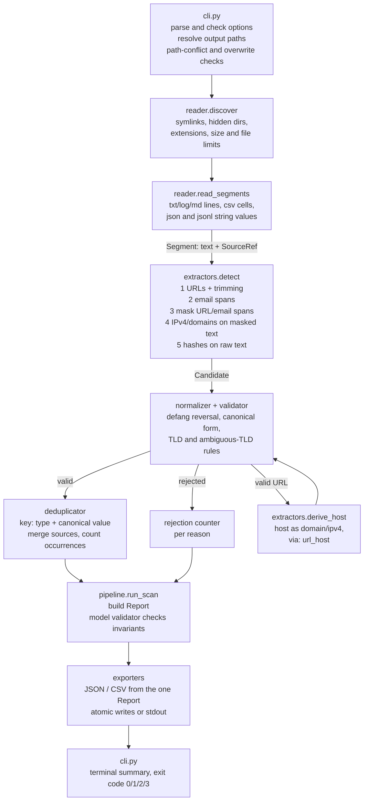

# Lucent architecture

Lucent is a single-process, offline pipeline. Each stage lives in its own module and talks to the
next through plain data objects, so detection, validation, deduplication and export can be tested
in isolation. The authoritative contract is [`SPEC.md`](SPEC.md); this page explains how the code
is laid out to meet it.

## Data flow

## Modules

| Module | Role |
|---|---|
| `cli.py` | Typer app. Option rules (usage errors exit 2), output target resolution, path-conflict and existing-output checks, exit-code mapping. No extraction logic. |
| `ui.py` | Terminal presentation only: gradient palette, ASCII banner, welcome screen, Typer help theme, scan summary (cards, bars, IOC table, status). Never touches report files or `--output -`. |
| `config.py` | Constants only: limits, extensions, rejection reasons, warning codes, IOC type order, output names, exit codes. |
| `reader.py` | Discovery (sorted by POSIX relative path) and format-aware readers that yield `Segment(text, SourceRef)`. Raises `FileFailure` for per-file read/parse failures. |
| `extractors.py` | Compiled, bounded regular expressions; URL trailing-punctuation trimming; span masking; `Candidate` objects with exact offsets into the raw segment. |
| `normalizer.py` | Defang reversal (`[.]` `(.)` `{.}` `[dot]` `(dot)`, `hxxp(s)`, `[://]`, `[:]//`), URL scheme/separator/authority normalization. Path, query and fragment are never touched. |
| `validator.py` | Per-type syntax checks returning `Outcome(ok, canonical, reason)`. Loads the bundled IANA TLD list and the ambiguous-TLD list once via `importlib.resources`. |
| `deduplicator.py` | Merges sightings by `(type, canonical value)`; sorts and caps sources and original values. |
| `models.py` | Pydantic v2 models. `Report` has a model validator that enforces every §B9.4 invariant, so an inconsistent report cannot be constructed. |
| `pipeline.py` | `process_segment` (detect, validate, derive) and `run_scan` (orchestration, per-file isolation, warnings/errors, status, injectable clock). Never prints. |
| `exporters.py` | `render_json`, `render_csv` (formula guard), `write_atomic` (temp file + `os.replace`), `write_stdout` (UTF-8 bytes). |

## Key design decisions

- **Detect on raw text.** Patterns accept defanged separators directly, so the matched substring is
  the exact `original_value` and offsets need no remapping. Normalization runs per candidate.
- **Mask before domains.** URL and email spans are blanked (same length) before IPv4/domain
  detection, so URL paths (`/files/other.com`) and email domains are not reported as bare domains.
  Hashes run on unmasked text so a hash in a URL query is still found.
- **Per-file isolation.** Sightings from a file are buffered and merged only after the whole file
  reads cleanly. A file that fails to parse contributes nothing and the scan continues (`partial`).
- **One report object.** JSON and CSV are serialized from the same validated `Report`; exporters
  never recompute counts.
- **Deterministic output.** Sorted discovery, sorted IOCs/sources/original values, model field
  order for JSON keys, and an injectable clock make two runs byte-identical.
- **Offline.** No module imports networking code. Tests run with an autouse fixture that makes any
  socket connection or DNS lookup raise. `scripts/update_tlds.py` (the only network user) is a
  developer tool outside the package.
